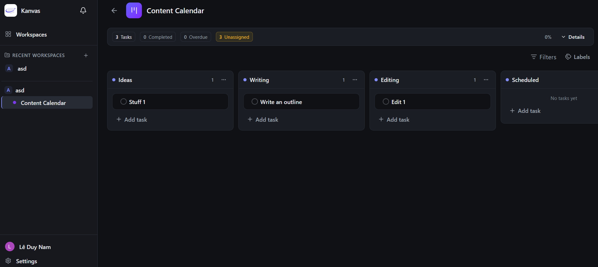
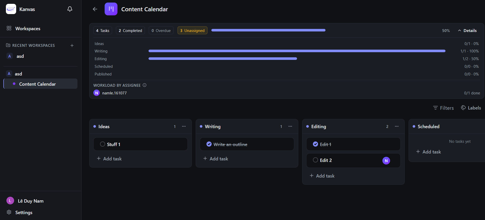
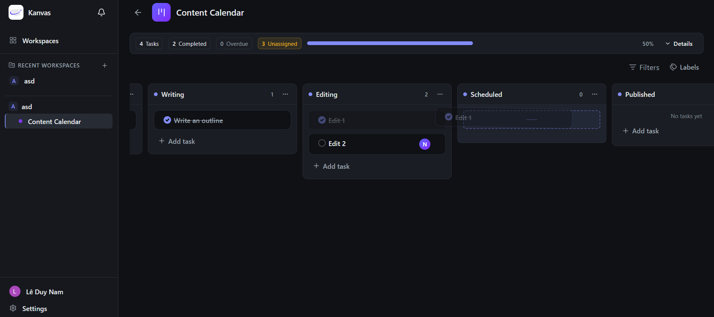

# Kanvas — Realtime, Conflict-Safe Kanban Board for Teams

A workspace-based Kanban board frontend. React + TypeScript + Vite SPA backed by the Go API (`kanban-board-be`) and Supabase Auth/Realtime.

[](https://github.com/LDukeH/kanban-board/actions/workflows/frontend-ci.yml)

## Live demo

- Demo URL: https://kanvas-board.vercel.app/
- Demo account: `demo@gmail.com` / `12345678` (sign in on the demo site with these credentials)
- Deployed API used by CI builds: `https://kanb1an-board-be.vercel.app/` (from `.github/workflows/frontend-ci.yml`)





> Screenshot path note: `docs/` is gitignored in this repo, so images live in `public/assets/...` (served verbatim from `public/`).

## Features

Verified against `src/`:

### Auth (`src/lib/api/auth.api.ts`, `src/components/auth/`, `src/pages/AuthPage.tsx`, `src/pages/ResetPasswordPage.tsx`)

- Supabase email/password sign-up and sign-in with hCaptcha (`CaptchaField`, `captchaToken` on every auth call).
- Password reset: request link (`ForgotPasswordForm`) and set a new password from the email link (`/auth/reset-password`).
- Google OAuth (`loginWithGoogle` -> `signInWithOAuth({ provider: "google" })`).
- Session sync to the Go API (`POST /auth/sync`, `GET /auth/me`), sign-out, profile update, account deletion (`DELETE /auth/me`).

### Workspaces and roles (`src/hooks/useWorkspaces.ts`, `src/hooks/useWorkspaceAccess.ts`, `src/lib/api/workspace.api.ts`, `src/lib/api/invitation.api.ts`)

- Workspaces with `owner` / `admin` / `member` roles. Capability flags in `useWorkspaceAccess` (`canManageMembers`, `canManageBoards`, `canEditWorkspace` owner-only, `canWorkOnTasks`, `canDeleteTask`, `canDeleteWorkspace`).
- Invitations: invite registered users by user ID, list/cancel pending invitations, accept/decline from the invitee's `workspace_invited` notification (`NotificationBell`).
- Ownership transfer: `POST /workspaces/{id}/transfer-ownership` with confirmation dialog (expects HTTP `204`).

### Boards, columns, tasks (`src/hooks/useBoard.ts`, `src/hooks/useColumnTasks.ts`, `src/lib/api/board.api.ts`, `src/lib/api/column.api.ts`, `src/lib/api/task.api.ts`, `src/components/board/`, `src/components/dialog/`, `src/components/task/`)

- Boards, columns, and tasks with persisted `position`s and drag-and-drop via `@dnd-kit/react` (`src/lib/dragDrop.ts`).
- Task planning metadata: `priority` (`none/low/medium/high/urgent`), `dueDate` (`YYYY-MM-DD`, tri-state set/clear/leave), `completed` boolean (`TaskCompleteToggle`, `CreateTaskDialog`, `EditTaskDialog`).
- Rich-text description: TipTap editor (`src/components/task/TaskDescriptionEditor.tsx`, `TaskRichTextToolbar.tsx`, `src/lib/description.ts`, `src/styles/tiptap.css`).
- Labels (board-scoped, `BoardLabels`, `label.api.ts`) and assignees (workspace members, `TaskAssigneeAvatars`, `useTaskAssignees.ts`).
- Comments per task (`comment.api.ts`, `useTaskComments.ts`, `TaskComments.tsx`).

### Collaboration (`src/lib/realtime/`, `src/components/layout/NotificationBell.tsx`, `src/hooks/useNotifications.ts`, `src/lib/api/notification.api.ts`)

- Realtime board sync over Supabase Broadcast on private `board:{boardId}` channels (`useBoardRealtime`, `useBoardRealtimeSync` in `src/pages/BoardPage.tsx`).
- Notifications: unread-count polling plus list, mark-read / mark-all-read, navigation to the task board or invite accept/decline.

### Productivity (`src/lib/taskFilter.ts`, `src/components/board/TaskFilterPopover.tsx`, `src/lib/templates/`, `src/hooks/useBoardTemplates.ts`, `src/hooks/useBoardSummary.ts`, `src/hooks/useWorkspaceSummary.ts`, `src/lib/summary.ts`)

- Client-side board filters (text, assignees, labels, priority, due, completion) persisted to the URL (`?q=`, `assignees=`, `labels=`, `priority=`, `due=`, `completion=`, `no_assignees=1`, `no_labels=1`) via `useSearchParams` in `BoardPage.tsx`, plus per-board local persistence (`saveBoardTaskFilter`).
- Board templates: built-in presets under `src/lib/templates/` materialized into a new board (`CreateBoardFromTemplateDialog`, `materializeBoardTemplate`).
- Progress summaries: client-derived board and workspace summaries (totals, by-column, overdue, by-assignee) from already-authorized caches.

## Engineering highlights

- **Optimistic concurrency with 409 rollback** — every task/column edit, delete, and move sends the cached `version` (`src/lib/api/task.api.ts`, `src/lib/api/column.api.ts`); `409`/`404` map to stale-snapshot errors with retry copy and cache invalidation (`src/lib/httpStatus.ts`, `src/hooks/useColumnTasks.ts`, `src/hooks/useBoard.ts`).
- **Per-task and per-column move gates plus durable replay** — rapid re-drags queue per task and per source/target column so a second PATCH never re-sends a bumped version (self-409 / neighbor-409); optimistic drops persist to `sessionStorage` (`kanban-pending-task-moves`) and replay after reload (`src/hooks/useColumnTasks.ts`, `src/lib/taskMove.ts`, `src/lib/staleMoveNotices.ts`).
- **Realtime via Supabase Broadcast with coalesced invalidation** — one private `board:{boardId}` channel per open board; bursts coalesce over `BOARD_REALTIME_DEBOUNCE_MS = 300` into a single predicate invalidation covering only that board's columns and task-list queries (`src/lib/realtime/useBoardRealtime.ts`, `src/lib/realtime/useBoardRealtimeSync.ts`).
- **TanStack Query key structure plus optimistic updates** — `["currentUser"]`, `["workspaces"]`, `["workspaces", id, "boards"/"members"/"invitations"/"task-summary"]`, `["boards", id]`, `["boards", id, "columns"]`, `["boards", id, "labels"]`, `["boards", id, "columns", columnId, "tasks"]`, `["notifications", ...]`; moves apply optimistic cache writes with rollback and `onSettled` refetch (`src/hooks/useBoard.ts`, `src/hooks/useColumnTasks.ts`, `src/lib/queryClient.ts`).
- **Typed API boundary** — `src/lib/api/*` is the only HTTP layer; backend `snake_case` maps to frontend `camelCase` in `src/types/` (e.g. `column_id` -> `columnId`, `due_date` -> `dueDate`); axios attaches the Supabase access token as `Authorization: Bearer` and clears `["currentUser"]` on `401` from `/auth/me` (`src/lib/api/axios.ts`).

## Tech stack

| Area            | Technology (from `package.json`)                                                                                             |
| --------------- | ---------------------------------------------------------------------------------------------------------------------------- |
| UI              | React 19, React DOM 19, TypeScript ~6.0.3                                                                                    |
| Build           | Vite 8, `@vitejs/plugin-react` 6, React Compiler (`babel-plugin-react-compiler`), Tailwind CSS 4 (`@tailwindcss/vite`)       |
| Routing         | `react-router-dom` 7                                                                                                         |
| Server state    | `@tanstack/react-query` 5                                                                                                    |
| Client state    | `zustand` 5 (persist: theme, selected workspace, recents)                                                                    |
| Forms           | `react-hook-form` 7, `@hookform/resolvers`, `zod` 4                                                                          |
| Drag and drop   | `@dnd-kit/dom` + `@dnd-kit/react` 0.5                                                                                        |
| Auth / realtime | `@supabase/supabase-js` 2, `@hcaptcha/react-hcaptcha` 2                                                                      |
| Editor          | TipTap 3 (`@tiptap/react`, `starter-kit`, extensions)                                                                        |
| UI kit          | `@base-ui/react`, `shadcn`, `class-variance-authority`, `clsx`, `tailwind-merge`, `tw-animate-css`, `lucide-react`, `motion` |
| HTTP            | `axios` 1                                                                                                                    |
| Tests           | `vitest` 5                                                                                                                   |

## Architecture

Folder layout (verified):

```text
src/
  main.tsx            QueryClientProvider + BrowserRouter + store bootstrap
  App.tsx             route definitions (lazy pages)
  index.css           Tailwind v4 entry
  styles/tiptap.css   editor styles
  pages/              one component per route (Auth, ResetPassword, Workspaces, Workspace, Board, Settings)
  routes/             GuestRoute / ProtectedRoute wrappers
  hooks/              TanStack Query hooks per resource (useAuth, useWorkspaces, useBoard, useBoards,
                      useColumnTasks, useTaskComments, useTaskAssignees, useNotifications,
                      useBoardTemplates, useBoardSummary, useWorkspaceSummary, useWorkspaceAccess)
  lib/
    api/              HTTP boundary: axios client + snake_case -> camelCase mappers
    realtime/         Supabase Broadcast channel + coalesced invalidation
    templates/        built-in board templates + materialize helper
    validations/      zod schemas shared by forms
    taskFilter.ts / dragDrop.ts / taskMove.ts / httpStatus.ts / summary.ts / ...
  components/
    auth/             login/register/forgot-password/OAuth/captcha forms
    board/            columns, task cards, labels, filter popover
    task/             description editor, comments, dialogs
    dialog/           create/edit dialogs (board, column, task, template, members, transfer)
    layout/           sidebar, dashboard layout, NotificationBell
    ui/               shadcn-style primitives
    workspace/        workspace cards and member dialogs
    dashboard/        board cards and grid
  stores/             theme, selected workspace, recents, invitations
  types/              frontend camelCase row types
```

```mermaid
flowchart LR
  Browser["Browser (Vite SPA)"] --> GoAPI["Go API (kanban-board-be on Vercel)"]
  GoAPI --> PG["PostgreSQL (Supabase-hosted)"]
  Browser --> SupaAuth["Supabase Auth (session + Bearer JWT)"]
  Browser --> SupaRT["Supabase Realtime Broadcast (board:{id})"]
  SupaRT <-- "Postgres trigger broadcast_board_event()" --- PG
```

No dev-server proxy: the browser calls the API directly over CORS with `VITE_API_URL` as the axios `baseURL`.

## Getting started

### Prerequisites

- Node.js: no `engines` field in `package.json`. CI installs Node `26` (see `.github/workflows/frontend-ci.yml`). The previous README required `^20.19.0 || >=22.12.0` for Vite 8.
- A running Go Kanban API backend (the frontend does not mock it).
- A Supabase project (Auth + Realtime) and an hCaptcha site key.

### Clone and install

```bash
git clone https://github.com/LDukeH/kanban-board.git
cd kanban-board
npm install
```

### Environment

Copy `.env.example` to `.env` (`.env` is gitignored, never commit it):

```bash
cp .env.example .env
```

`.env.example` contents:

```env
VITE_API_URL=http://localhost:3000
VITE_SUPABASE_URL=https://your-project.supabase.co
VITE_SUPABASE_PUBLISHABLE_KEY=your-supabase-publishable-key
VITE_HCAPTCHA_SITE_KEY=your-hcaptcha-site-key
```

| Variable       | Required? | Description                                                                    | Example                                                                                    |
| -------------- | --------- | ------------------------------------------------------------------------------ | ------------------------------------------------------------------------------------------ |
| `VITE_API_URL` | Yes       | Go API base URL, used verbatim as the axios `baseURL` (`src/lib/api/axios.ts`) | `http://localhost:3000` locally; `https://kanban-board-be.vercel.app/` deployed (CI value) |

| `VITE_SUPABASE_URL` | Yes | Supabase project URL (Auth + Realtime) | `https://your-project.supabase.co` |
| `VITE_SUPABASE_PUBLISHABLE_KEY` | Yes | Supabase publishable key embedded in the browser build | `your-supabase-publishable-key` |
| `VITE_HCAPTCHA_SITE_KEY` | Yes | hCaptcha site key for sign-in / sign-up / password-reset challenges | `your-hcaptcha-site-key` |
| `LIVE_API_BASE_URL` | Live tests only | Per-run override for `npm run test:api`; falls back to built `VITE_API_URL`, then `http://localhost:3000` (`test/live/helpers/env.ts`) | `http://localhost:3000` |
| `SUPABASE_URL` | Live tests only | Test-process Supabase URL for creating users via the Admin API | `https://your-project.supabase.co` |
| `SUPABASE_SERVICE_ROLE_KEY` | Live tests only | Secret/service-role key, test process only — never `VITE_*`, never frontend code, never committed | `sb_secret_...` |

Live API tests create users through the Supabase Admin API so they do not
depend on hCaptcha. Set the service-role credentials in the test process only
(never in `VITE_*` variables or frontend code):

```env
SUPABASE_URL=https://your-project.supabase.co
SUPABASE_SERVICE_ROLE_KEY=your-service-role-key
```

`npm run test:api` loads these non-`VITE_` variables from the repository `.env`
as well. Use the Supabase **secret/service_role** key, not
`VITE_SUPABASE_PUBLISHABLE_KEY`.

Run `npm run test:api` only in a disposable test environment. The service-role
key has full database privileges and must not be committed or exposed to the
browser.

### Run the dev server

```bash
npm run dev
```

Vite defaults to `http://localhost:5173`.

## Backend dependency

- Backend repo: https://github.com/LDukeH/kanban-board-be
- Local: point `VITE_API_URL=http://localhost:3000` at your locally running Go API.
- Deployed: the CI build uses `VITE_API_URL=https://kanban-board-be.vercel.app/` (see `env:` in `.github/workflows/frontend-ci.yml`).

## Scripts

From `package.json`:

| Command              | What it does                                                                                          |
| -------------------- | ----------------------------------------------------------------------------------------------------- |
| `npm run dev`        | Start the Vite dev server with HMR                                                                    |
| `npm run build`      | Type-check (`tsc -b`) then production build into `dist/`                                              |
| `npm run lint`       | Run ESLint (`eslint .`)                                                                               |
| `npm run preview`    | Serve the production build locally                                                                    |
| `npm test`           | Offline unit suite (`vitest run`), no backend needed                                                  |
| `npm run test:watch` | Offline suite in watch mode (`vitest`)                                                                |
| `npm run test:api`   | Live API suite (`vitest run --config vitest.live.config.ts`, `test/live/**`), requires the Go backend |
| `npm run test:types` | Type-check the test project (`tsc -p tsconfig.test.json`)                                             |

### Supabase and CORS notes

Enable hCaptcha in the Supabase dashboard under **Authentication → Bot and
Abuse Protection**, configure the hCaptcha secret key there, and add the
corresponding site key to `VITE_HCAPTCHA_SITE_KEY`. The sign-in, sign-up, and
password-reset forms send the challenge token to Supabase Auth.

For local development, add `localhost` (and `127.0.0.1` if you use that
address) to the allowed hostnames for the hCaptcha site key. The
`localhost detected` warning is from hCaptcha and means the site key does not
recognize the local host. Supabase may then reject sign-in with HTTP 400
because the captcha token cannot be verified. Use a separate site key for
local development if the production key cannot include local hostnames.

`VITE_API_URL` is read by the axios client (`src/lib/api/axios.ts`) and used
verbatim as the base URL. Supabase Auth manages the browser session and axios
sends its access token as an `Authorization: Bearer` header to the Go API.
There is no dev-server proxy: the browser calls the API directly, so the backend must allow the frontend origin via CORS.

The password-reset email returns to `/auth/reset-password`. Add the local and
production URLs (for example, `http://localhost:5173/auth/reset-password`) to
the Supabase project's **Authentication → URL Configuration → Redirect URLs**.

### Password-reset email delivery

`resetPasswordForEmail` returning successfully (and an Auth `/recover` log with
status `200`) means Supabase accepted the request; it does not guarantee that
an email reached the recipient. Before testing password reset:

1. In **Authentication → Providers → Email**, enable email/password auth.
2. In **Authentication → SMTP Settings**, configure a custom SMTP provider for
   recipients outside the Supabase project team. The built-in Supabase email
   service is intended for testing, is heavily rate-limited, and can silently
   fail to deliver to arbitrary recipients.
3. In **Authentication → Email Templates → Reset Password**, verify the
   template is enabled and check that the sender address/domain is valid.
4. Check the provider's delivery logs and the recipient's spam folder.

The application intentionally shows a generic success message after the
request, so it does not reveal whether an email address belongs to an account.

If signup fails with `POST /auth/v1/signup` and HTTP `500`, inspect the
Supabase Auth log's `error`/`msg` field. Messages such as `Error sending
confirmation email` or `Database error saving new user` indicate a Supabase
project configuration/service problem, not an API request from this frontend:
verify custom SMTP credentials and sender/domain settings, then retry after
checking the SMTP provider logs. The publishable key and URL in the frontend
must also belong to the same Supabase project.

## Testing

```bash
npm test            # offline unit suite (vitest run), no backend needed
npm run test:types  # type-check the test project (tsconfig.test.json)
npm run test:api    # live API suite (test/live/**) against the real backend
```

Live-suite requirements (`test/live/helpers/env.ts`, `test/live/helpers/session.ts`, `vitest.live.config.ts`):

- A running Go API backend. Target it with `LIVE_API_BASE_URL`, otherwise the suite falls back to the built `VITE_API_URL`, then `http://localhost:3000`.
- `SUPABASE_URL` plus `SUPABASE_SERVICE_ROLE_KEY` (secret/service-role key, `sb_secret_...` or legacy `service_role`) in the test process only. Live tests create real users via the Supabase Admin API so they do not depend on hCaptcha. Never put the service-role key in `VITE_*` or frontend code, and run `npm run test:api` only against a disposable test environment (full database privileges, never committed or exposed to the browser).
- The live suite owns real sessions, so it runs serially (`fileParallelism: false`, 20s timeouts) and writes machine-readable reports to `test-results/` (gitignored, local-only).

## CI and deployment

Workflow `.github/workflows/frontend-ci.yml` (runs on `push` / `pull_request` to `main`, plus manual dispatch; `VITE_API_URL` pinned to the deployed API for the build):

| Job                 | Steps                                      |
| ------------------- | ------------------------------------------ |
| Frontend lint       | `npm ci` -> `npm run lint` (Node 26)       |
| Frontend test types | `npm ci` -> `npm run test:types` (Node 26) |
| Frontend test       | `npm ci` -> `npm test` (Node 26)           |
| Frontend build      | `npm ci` -> `npm run build` (Node 26)      |

Deployment: static SPA on Vercel. `vercel.json` rewrites every path to `/index.html` so `react-router-dom` (`BrowserRouter`) handles client-side routes.

```json
{
  "rewrites": [{ "source": "/(.*)", "destination": "/index.html" }]
}
```

## Routes

From `src/App.tsx` (pages lazy-loaded; unknown paths redirect to `/auth`):

| Path                       | Page                                                           | Access                       |
| -------------------------- | -------------------------------------------------------------- | ---------------------------- |
| `/auth`                    | Login / register / request password reset (`AuthPage`)         | Guest only (`GuestRoute`)    |
| `/auth/reset-password`     | Choose a new password from an email link (`ResetPasswordPage`) | Public (link flow)           |
| `/workspaces`              | All workspaces (`WorkspacesPage`)                              | Signed in (`ProtectedRoute`) |
| `/workspaces/:workspaceId` | Workspace boards (`WorkspacePage`)                             | Signed in                    |
| `/boards/:boardId`         | Kanban board (`BoardPage`)                                     | Signed in                    |
| `/settings`                | Account and theme (`SettingsPage`)                             | Signed in                    |

## Roadmap / Not included

Verified as absent from `src/` (only appear as future plans in `docs/plan/plan.md`, which is gitignored and not shipped):

- Global search / command palette across workspaces and boards.
- Bulk task actions (multi-select move/assign/label/priority/delete).
- Activity / audit log.
- `viewer` role (roles are `owner` / `admin` / `member` only).
